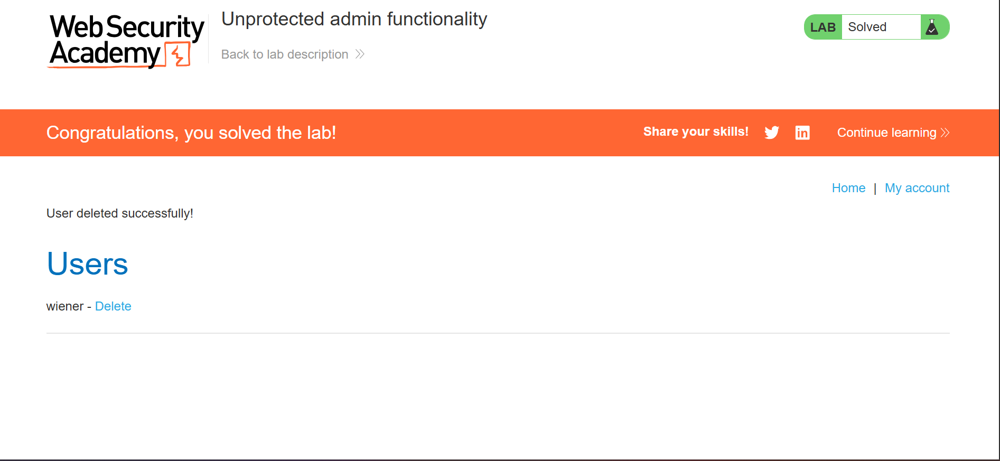

# Server-Side Vulnerabilities: Access Control & Privilege Escalation

Welcome to this section of my web security research. This module documents my hands-on learning experience identifying and exploiting **Broken Access Control**, specifically focusing on **Vertical Access Control flaws (Privilege Escalation)**.

The practical portion of this research was completed successfully on the **PortSwigger Web Security Academy** lab: *Unprotected admin functionality*.

---

## 🧠 Core Concepts Learned

### 1. What is Access Control (Authorization)?
Access control is the backend security mechanism that enforces policies stating **what** a user is permitted to do. While *Authentication* verifies identity (who you are), *Access Control* restricts operations based on privileges (what you can do). 

### 2. Vertical Access Control & Privilege Escalation
Vertical Access Control enforces boundaries between different tiers of user roles, such as standard users, managers, and administrators. 
* **The Vulnerability:** A vertical access control flaw occurs when an application fails to check user permissions before serving an administrative resource or executing a privileged action.
* **The Exploit:** An unprivileged attacker leverages this lack of server-side validation to elevate their privileges horizontally or vertically, gaining unauthorized access to functions intended exclusively for high-level roles.

### 3. The Risk of Unprotected Administrative Functions (Security by Obscurity)
Many applications rely on "Security by Obscurity"—believing that if a sensitive URL or endpoint is not linked anywhere on the public page, a normal user will never find it. 
* Developers might hide an admin portal at an unlinked directory (e.g., `/admin-panel-xyz`).
* If the backend lacks validation logic ensuring the current session belongs to a legitimate administrator, anyone who guesses, brute-forces, or discovers the URL via open-source intelligence (OSINT) gets full administrative access.

---

## 🛠️ Tooling & Hands-on Methodology

In this lab, I identified a case where sensitive administration functionality was left entirely unprotected and exposed to unauthenticated users.

### Step-by-Step Lab Execution:

1. **Mapping and Information Gathering:** I systematically explored the target web application, checking for sensitive files, common directory patterns, or comments hidden inside the source layout.
2. **Endpoint Discovery:** I discovered an unlinked administrative panel hosted on a predictable path:
   ```http
   GET /admin HTTP/2
   Host: vulnerable-academy-instance.net
   ```
3. **Flaw Verification:** Because the server completely lacked server-side authorization check logic for this panel, navigating directly to the URL opened up the administrative interface—even though I was logged in as a regular user or unauthenticated guest.
4. **Targeted Exploitation (User Deletion):** Inside the exposed panel, I identified user management controls. I triggered the action to delete a specific user account:
   ```http
   GET /admin/delete?username=carlos HTTP/2
   Host: vulnerable-academy-instance.net
   ```
5. **Impact Confirmation:** The server executed the database deletion request unconditionally. The user account `carlos` was successfully deleted, solving the lab challenge.

---

## 📸 Lab Proof & Screenshots

Below is the verified screenshot demonstrating the exposed admin portal, the command interface, and the confirmation showing that the user account was successfully deleted.



---

## 🛡️ Mitigation Strategies (How to Fix It)

To prevent privilege escalation vulnerabilities, backend developers must employ robust access control frameworks:
1. **Never Rely on Obscurity:** Assume all application endpoints, file systems, and paths will be discovered by an attacker. 
2. **Deny by Default:** Design access control systems to deny access to resources automatically unless a user role explicitly matches a strict whitelist profile.
3. **Enforce Server-Side Checks on Every Request:** Every single time a user hits a privileged endpoint (especially sensitive actions like `/delete` or `/update`), the server code must intercept the request, inspect the active session token, and verify authorization *before* executing the backend command.
